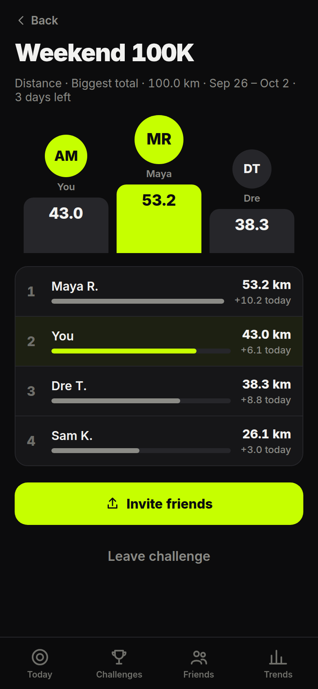

# Gauntlet

Fitness challenges with your friends, on top of [SparkyFitness](https://github.com/CodeWithCJ/SparkyFitness).
Pick any metric (steps, distance, active minutes, calories, workouts, sleep, resting heart rate, or any
SparkyFitness custom measurement), set the rules, invite your crew, and race.

- **PWA** (installable web app) and **Android app** from one React codebase (Capacitor).
- **SparkyFitness holds all raw health data.** Gauntlet stores only users, friends, challenges and a
  per-day scoring cache that can be rebuilt at any time.
- Sign in with your SparkyFitness account. Devices (Garmin, Strava, Fitbit, Oura, Polar, Withings…)
  are connected in SparkyFitness; on Android, Gauntlet can also push Health Connect data into it.

<p>
  
  
  
  
</p>

## How it fits together

```
PWA / Android app ──HTTPS──▶ Gauntlet API (Node) ──per-user API key──▶ SparkyFitness (bundled)
        │                          │                                      │
   Health Connect ── records ──────┘ (forwarded, not stored)        one Postgres, two databases
```

Gauntlet ships with its own SparkyFitness, which holds everyone's health data; Gauntlet itself
stores accounts, friends and challenges. Both run on Fly.io (see Release and deploy).

- **Accounts:** "Create an account" in the app makes the SparkyFitness account behind the scenes.
  Signing in (email/password, with 2FA if enabled) gets the API to create an API key named
  "Gauntlet" in your SparkyFitness account, store it encrypted (AES-256-GCM), and sign the
  SparkyFitness session out. People who'd rather use another SparkyFitness can sign in with an API
  key from it (Android: Advanced).
- **Sync:** every 15 minutes the API pulls data for everyone in a running challenge, and on demand
  when you pull to refresh. SparkyFitness stores the same metric in different places depending on the
  source; `packages/sparky/src/merge.ts` turns that into one number per day. Sources are never added
  together (a watch and a phone count the same walk), the highest single source wins.
- **Privacy:** friends see challenge totals and ranks only. Which app your data came from is shown
  on the feed only if you allow it.

## Repository

| Path              | What                                                                                               |
| ----------------- | -------------------------------------------------------------------------------------------------- |
| `packages/shared` | Metric catalog, scoring engine (total, race to target, daily average, best day, streak), API types |
| `packages/sparky` | SparkyFitness client and the multi-source merge, shared by the API and the Android app             |
| `apps/api`        | Fastify API: accounts, friends, invites, challenges, feed, scheduler                               |
| `apps/web`        | React PWA; `apps/web/android` is the Capacitor Android project                                     |
| `deploy/`         | `fly/`: Fly.io deploy; `docker-compose.yml`: the whole backend on one machine; `smoke.sh`          |
| `scripts/`        | `make-keystore.sh`: creates the Android release signing key                                        |
| `design/`         | Mockups, icon, and screenshots of the real app (`design/app/`)                                     |

## Develop

Needs Node 22, pnpm 10 and Postgres 16.

```bash
pnpm install
createdb gauntlet && createdb gauntlet_test

# API against a fake SparkyFitness with a seeded crew (resets the database it is given)
DATABASE_URL=postgres://localhost/gauntlet pnpm --filter @gauntlet/api demo
# Web app on http://localhost:5173, proxied to the API on :8080
pnpm --filter @gauntlet/web dev
# Sign in as you@example.com / demo
```

To check a real SparkyFitness account (read-only; prints what Gauntlet would score for the last week):

```bash
SPARKY_TEST_KEY=<api key> pnpm --filter @gauntlet/api live-check
```

To develop against your real server instead, copy `apps/api/.env.example` to `apps/api/.env`, fill it
in, and run `pnpm --filter @gauntlet/api dev`.

```bash
pnpm typecheck
TEST_DATABASE_URL=postgres://localhost/gauntlet_test pnpm test   # unit + API integration tests
pnpm --filter @gauntlet/web build && pnpm --filter @gauntlet/web e2e   # needs the demo API running
```

## Release and deploy

Everything runs on [Fly.io](https://fly.io) as five small apps: Gauntlet (API + PWA), the
SparkyFitness server, the SparkyFitness website, and one Postgres holding both databases.
Publishing a GitHub release builds the signed APK, attaches it to the release and deploys all of it,
with the APK downloadable from the app's Profile page. One-time setup, custom domains through
Cloudflare, backups and costs (about $11–13 a month): [`deploy/fly/README.md`](deploy/fly/README.md).

To run the same backend on any machine with Docker: copy `deploy/.env.example` to `deploy/.env`,
fill in the secrets, and run `docker compose -f deploy/docker-compose.yml --env-file deploy/.env up -d --build`.
`deploy/smoke.sh <gauntlet url> <sparkyfitness url>` then signs up a test account, pushes steps and
reads them back (CI does this on every push).

Keep `ENCRYPTION_KEY`, `BETTER_AUTH_SECRET` and the SparkyFitness encryption key stable: changing
them makes stored keys unreadable and signs everyone out.

## Android

```bash
pnpm --filter @gauntlet/web cap:sync      # builds with apps/web/.env.native (VITE_API_URL)
cd apps/web/android && ./gradlew assembleDebug
```

- The app signs in (or creates an account) through your Gauntlet server. Release builds point at
  `GAUNTLET_PUBLIC_URL` and `SPARKY_PUBLIC_URL` (repository variables; `.env.native` for local
  builds).
- **Apps and devices** are connected from Data sources: Garmin, Strava, Fitbit, Oura, Polar, COROS,
  Hevy, Liftosaur and wger. SparkyFitness does the connecting and keeps the data synced; the app is a
  friendlier front for it (setup in `deploy/fly/README.md`).
- **Advanced: SparkyFitness only.** With an API key (SparkyFitness → Settings → API keys) and no
  Gauntlet server, the phone talks straight to SparkyFitness (Today, Trends, Data sources, Health
  Connect sync). Friends and challenges need a server; connect one later under Me. The key is kept in
  Android Keystore-backed storage.
- Pushes and pull requests build a debug APK (artifact `gauntlet-android`).
- Health Connect: the app asks for read access only (steps, distance, active calories, resting heart
  rate, sleep, exercise, history) and syncs when opened or resumed. Records use the same format and
  source name as the SparkyFitness app, so if you already run that, you only need one of them syncing.
- Icons and splash screens come from `apps/web/public/icons/*.svg`: `pnpm --filter @gauntlet/web icons`.

## Status

Built and tested: API flows (password, 2FA and API-key login; friends; invite links; challenges in
every scoring mode; multi-source sync; feed; finalization; rematch; revoked keys), the PWA (Playwright
walkthrough of every screen), the production layout, and an Android debug build.

Verified against fit.randalls.cc with a real account: API-key sign-in, sync, Today, a steps
challenge, Trends and Data sources. That data led to the workout clean-up rules in
`packages/sparky/src/merge.ts`, which drop stuck sessions over 6 hours and duplicates written by two
apps, and cap sleep at time in bed.

Verified against the bundled SparkyFitness (v1.7.3, real container): creating an account through
Gauntlet, password sign-in, pushing Health Connect-style records and reading them back on Today.
Not yet verified: the live Fly.io deploy (needs your Fly account), 2FA against a real server, and
Health Connect on a physical device. Push notifications and background Health Connect sync
(WorkManager) are planned follow-ups.
