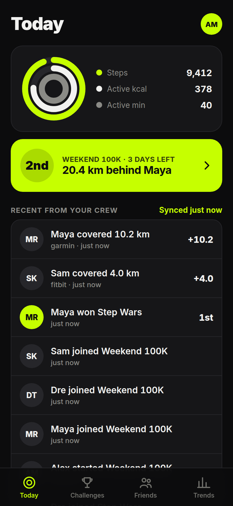

# Gauntlet

Fitness challenges with your friends, on top of [SparkyFitness](https://github.com/CodeWithCJ/SparkyFitness).
Pick any metric (steps, distance, active minutes, calories, workouts, sleep, resting heart rate, or any
SparkyFitness custom measurement), set the rules, invite your crew, and race.

- **PWA** (installable web app) and **Android app** from one React codebase (Capacitor).
- **SparkyFitness holds all raw health data.** Gauntlet stores only users, friends, challenges and a
  per-day scoring cache that can be rebuilt at any time.
- Sign in with your SparkyFitness account. Devices (Garmin, Strava, Fitbit, Oura, Polar, Withings…)
  are connected in SparkyFitness; on Android, Gauntlet can also push Health Connect data into it.

<p>
  
  
  
  
</p>

## How it fits together

```
PWA / Android app ──HTTPS──▶ Gauntlet API (Node + Postgres) ──per-user API key──▶ SparkyFitness
        │                          │
   Health Connect ── records ──────┘ (forwarded to SparkyFitness, not stored)
```

- **Sign-in:** the API signs in to SparkyFitness for you (email/password, with 2FA if enabled),
  creates an API key named "Gauntlet" in your account, stores it encrypted (AES-256-GCM), and signs
  the SparkyFitness session out. Accounts created with Google sign-in have no password, so they
  paste an API key instead (SparkyFitness → Settings → API keys).
- **Sync:** every 15 minutes the API pulls data for everyone in a running challenge, and on demand
  when you pull to refresh. SparkyFitness stores the same metric in different places depending on the
  source; `apps/api/src/sparky/merge.ts` turns that into one number per day. Sources are never added
  together (a watch and a phone count the same walk), the highest single source wins.
- **Privacy:** friends see challenge totals and ranks only. Which app your data came from is shown
  on the feed only if you allow it.

## Repository

| Path | What |
| --- | --- |
| `packages/shared` | Metric catalog, scoring engine (total, race to target, daily average, best day, streak), API types |
| `apps/api` | Fastify API, SparkyFitness client and merge, friends, invites, challenges, feed, scheduler |
| `apps/web` | React PWA; `apps/web/android` is the Capacitor Android project |
| `deploy/` | Docker Compose, env template, reverse-proxy and App Links examples |
| `design/` | Mockups, icon, and screenshots of the real app (`design/app/`) |

## Develop

Needs Node 22, pnpm 10 and Postgres 16.

```bash
pnpm install
createdb gauntlet && createdb gauntlet_test

# API against a fake SparkyFitness with a seeded crew (resets the database it is given)
DATABASE_URL=postgres://localhost/gauntlet pnpm --filter @gauntlet/api demo
# Web app on http://localhost:5173, proxied to the API on :8080
pnpm --filter @gauntlet/web dev
# Sign in as you@example.com / demo
```

To check a real SparkyFitness account (read-only; prints what Gauntlet would score for the last week):

```bash
SPARKY_TEST_KEY=<api key> pnpm --filter @gauntlet/api live-check
```

To develop against your real server instead, copy `apps/api/.env.example` to `apps/api/.env`, fill it
in, and run `pnpm --filter @gauntlet/api dev`.

```bash
pnpm typecheck
TEST_DATABASE_URL=postgres://localhost/gauntlet_test pnpm test   # unit + API integration tests
pnpm --filter @gauntlet/web build && pnpm --filter @gauntlet/web e2e   # needs the demo API running
```

## Deploy

```bash
cp deploy/.env.example deploy/.env       # fill in POSTGRES_PASSWORD, JWT_SECRET, ENCRYPTION_KEY
docker compose -f deploy/docker-compose.yml --env-file deploy/.env up -d --build
```

One container serves the API (`/api`) and the PWA on port 8080. Put it behind the same reverse proxy
as SparkyFitness, e.g. `gauntlet.randalls.cc` (see `deploy/Caddyfile.example`). Keep
`ENCRYPTION_KEY` stable: changing it makes every stored SparkyFitness key unreadable, and everyone has
to sign in again.

No changes are needed on the SparkyFitness server: Gauntlet calls it server-side, so its CORS and
trusted-origin settings don't apply to the apps. One thing to know: SparkyFitness allows 4 sign-ins
per minute per IP, and every Gauntlet sign-in comes from Gauntlet's server. If several people sign
in at once they may see "too many attempts"; raise `SPARKY_FITNESS_SIGN_IN_RATELIMIT_*` on the
SparkyFitness server if that becomes a problem. (Syncing uses API keys and isn't affected.)

## Android

```bash
pnpm --filter @gauntlet/web cap:sync      # builds with apps/web/.env.native (VITE_API_URL)
cd apps/web/android && ./gradlew assembleDebug
```

- `apps/web/.env.native` points the app at `https://gauntlet.randalls.cc`. Change it if you host
  Gauntlet elsewhere, and update the App Links host in `AndroidManifest.xml`.
- CI builds a debug APK on every push (artifact `gauntlet-android`). For a signed release APK, add
  repository secrets `ANDROID_KEYSTORE_BASE64`, `ANDROID_KEYSTORE_PASSWORD`, `ANDROID_KEY_ALIAS`,
  `ANDROID_KEY_PASSWORD`.
- So invite links open the app directly, serve `deploy/assetlinks.json` (with your release key's
  SHA-256) at `/.well-known/assetlinks.json`.
- Health Connect: the app asks for read access only (steps, distance, active calories, resting heart
  rate, sleep, exercise, history) and syncs when opened or resumed. Records use the same format and
  source name as the SparkyFitness app, so if you already run that, you only need one of them syncing.
- Icons and splash screens come from `apps/web/public/icons/*.svg`: `pnpm --filter @gauntlet/web icons`.

## Status

Built and tested: API flows (password, 2FA and API-key login; friends; invite links; challenges in
every scoring mode; multi-source sync; feed; finalization; rematch; revoked keys), the PWA (Playwright
walkthrough of every screen), the production layout, and an Android debug build.

Verified against fit.randalls.cc with a real account: API-key sign-in, sync, Today, a steps
challenge, Trends and Data sources. That data led to the workout clean-up rules in
`apps/api/src/sparky/merge.ts`, which drop stuck sessions over 6 hours and duplicates written by two
apps, and cap sleep at time in bed. Not yet verified: password and 2FA sign-in against the real server,
and Health Connect on a physical device. Push notifications and background Health Connect sync
(WorkManager) are planned follow-ups.
